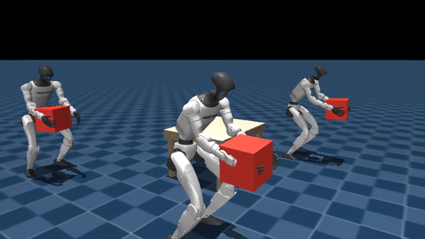

# unitree-g1-humanoid-pick

> **Bimanual pick policy for the Unitree G1 — walk to a table, plant the feet, grasp the box with both hands.** PPO on top of a walk-pretrained actor via shape-filtered warm-start + progressive layer unfreezing. Emits the terminal-state buffer that boots carry and place.

[](LICENSE)
[](https://www.python.org/downloads/release/python-3100/)
[](https://github.com/google-deepmind/mujoco)
[](https://github.com/mujocolab/mjlab)
[](https://github.com/leggedrobotics/rsl_rl)
[](https://onnx.ai/)

<p align="center">
  
</p>
<p align="center"><sub>Grid of 4 rollouts of the trained pick policy — bimanual approach, symmetric contact on the box side faces, and lift. GIF generated from the latest checkpoint via <code>scripts/make_portfolio_media.py</code>.</sub></p>

## What this does

- Trains a humanoid to **walk to a table, plant both feet, grasp a rigid box symmetrically with both hands, and lift it off the surface**.
- Reuses the walk prior via a **shape-filtered checkpoint load** + **progressive layer unfreezing** (Howard & Ruder, 2018), so the walk behaviour is preserved while the pick head adapts.
- Resets from the **walk terminal-state buffer**, so pick episodes always start from a balanced walking posture (not a static keyframe).
- Emits a **pick terminal-state buffer** (`outputs/pick_terminal_states.npz`) that in turn boots carry and place.
- Carries a **time-based curriculum** that eases the task via a `hand_bias` schedule: box spawns in the hands at step 0, slides to the table by step 4 M.

## Pipeline position

Middle of the chain: consumes walk's buffer, produces the buffer that boots carry and place.

```
     walk_terminal_states.npz
                │
                ▼
┌───────────┐              ┌───────────┐    pick_terminal_states.npz
│   WALK    │────warm────▶ │   PICK    │────────────────────────────┐
└───────────┘   (actor)    │  (here)   │                            │
                           └───────────┘                            ▼
                                                            ┌───────────────┐
                                                            │ CARRY / PLACE │
                                                            └───────────────┘
```

## Reproduce

### Quick smoke run (laptop GPU, ~5 min)

```bash
git clone https://github.com/narayanerm/unitree-g1-humanoid-pick.git
cd unitree-g1-humanoid-pick
uv pip install -r requirements.txt
jupyter lab 01a_pick.ipynb
```

Set `DEBUG_LIGHT = True` (64 envs × 3 iters) and Run All.

### Full training (B300-class GPU, ~4–6 h)

Leave `DEBUG_LIGHT = False`. The notebook:
1. Pulls or regenerates `outputs/walk_terminal_states.npz` (from the sibling walk repo).
2. Trains PPO with warm-start + progressive unfreeze.
3. Emits `outputs/pick_terminal_states.npz`.
4. Exports the actor to ONNX.

Flags: `REUSE_TRAINING`, `RESUME`, `WARM_START_FROM_REACH`, `WARM_START_FROM_CARRY`, `DEBUG_LIGHT`.

### Regenerate the walk terminal buffer

```bash
python -m src.collect_buffer \
    --policy-module src.policy_walk \
    --checkpoint <path/to/walk/model_*.pt> \
    --out outputs/walk_terminal_states.npz \
    --num-envs 2048 --n-snapshots 20000
```

### Deploy

```python
from src.utils import export_policy_to_onnx
export_policy_to_onnx(
    "outputs/logs/g1_pick/<run>/model_*.pt",
    "Mjlab-G1-Pick",
    "outputs/g1_pick.onnx",
)
```

### Inspect

```bash
python view.py                       # viser at http://localhost:8080
tensorboard --logdir outputs/logs/g1_pick
```

## Technology stack

| Component           | Choice                                                                         |
| ------------------- | ------------------------------------------------------------------------------ |
| Physics simulator   | MuJoCo Warp (GPU-parallel) via **mjlab**                                       |
| RL algorithm        | PPO (`rsl_rl`), adaptive LR, GAE(λ=0.95), clip=0.2                             |
| Policy architecture | 3-layer MLP (512→256→128, ELU), observation normalisation                      |
| Transfer learning   | Shape-filtered warm-start + **progressive layer unfreeze**                     |
| Reset event         | Sample from walk terminal buffer → snap arms to `READY_ARM_POSE`               |
| Curriculum          | Time-based `hand_bias` 1.0→0.0 and `pick_scale` 0.3→1.0 between 2 M–4 M steps  |
| Data augmentation   | Sagittal-plane mirror ([src/symmetry.py](src/symmetry.py))                     |
| Deployment          | ONNX export (fused normaliser, embedded policy Hz + joint order)               |
| Compute target      | 1× NVIDIA B300 SXM6 (tuned); scalable via `src/tiers.py`                       |

## Architecture highlights

- **Progressive unfreeze preserves the walk prior.** `_DEFAULT_UNFREEZE_SCHEDULE` in `src/train_loop.py` keeps `mlp.2`/`mlp.4` frozen for the first iters, then thaws them one at a time. Prevents the pick head from clobbering locomotion gradients before it stabilises.
- **Reset from a walking distribution, not a keyframe.** `reset_from_walk_buffer` samples real walk-terminal states, so pick training sees the *distribution* the walk policy actually produces at episode-end — not a sanitised initial pose.
- **Time-based `hand_bias` curriculum.** Box starts in the hands (bias=1), then slides to the table over 2 M–4 M env steps. Removes the sparse-reward cold start and gives the policy a clear gradient signal from step 0.
- **Sagittal-plane mirror aug assumes robot yaw ≈ 0.** Enforced at reset: the robot always faces +x towards the table, so the mirror can collapse to a plain joint-side swap + y-sign flip. Encoded in `_JOINT_MIRROR_MAP` + `_PICK_OBS_LAYOUT`, both runtime-asserted.
- **ONNX export sniffs trunk-frozen heads.** `export_policy_to_onnx` detects the diagnostic trunk-frozen architecture (`mlp.6.0.*` keys) and rebuilds the head as `Sequential(Linear, ELU, Linear)` before loading — otherwise shape mismatch.

## Visual assets

```bash
python scripts/make_portfolio_media.py outputs/media/<pick_rollout>.mp4
# writes docs/demo.gif + docs/frame_map.png
```

## Chain

| Repo | Role |
| --- | --- |
| [walk](../unitree-g1-humanoid-walk) | Base locomotion + warm-start |
| [reach](../unitree-g1-humanoid-reach) | Alt warm-start (arm manifold overlaps with grasp approach) |
| **[pick](.)** ← you are here | Walk to table + bimanual grasp |
| [carry](../unitree-g1-humanoid-carry) | Walk while carrying (consumes pick's terminal buffer) |
| [place](../unitree-g1-humanoid-place) | Set the carried box down |
| [fsm](../unitree-g1-humanoid-fsm) | Chain experts into a unified BC dataset |
| [monolithic-policy](../unitree-g1-humanoid-monolithic-policy) | Single MLP end-to-end alternative |

## Citation

```bibtex
@misc{medeiros2026g1pick,
  author       = {Ribeiro Medeiros, Narayane},
  title        = {unitree-g1-humanoid-pick: bimanual box pick policy for the Unitree G1 in mjlab},
  year         = {2026},
  howpublished = {\url{https://github.com/narayanerm/unitree-g1-humanoid-pick}}
}
```

## Author

**Narayane Ribeiro Medeiros** — ITAndroids Humanoid Team, Instituto Tecnológico de Aeronáutica.
[GitHub](https://github.com/narayanerm) · [LinkedIn](https://www.linkedin.com/in/narayanerm) · narayane.rm@gmail.com

Released under the [MIT License](LICENSE).
